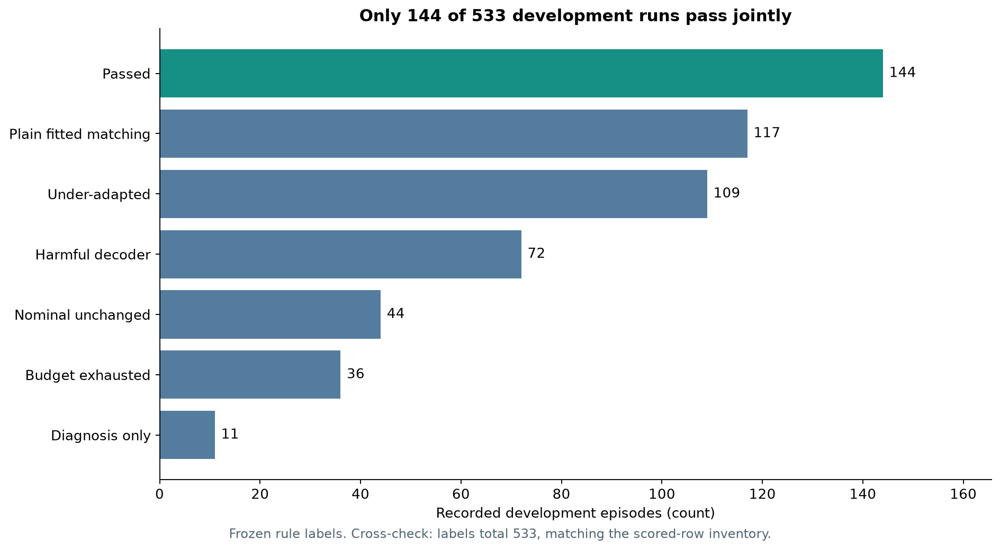
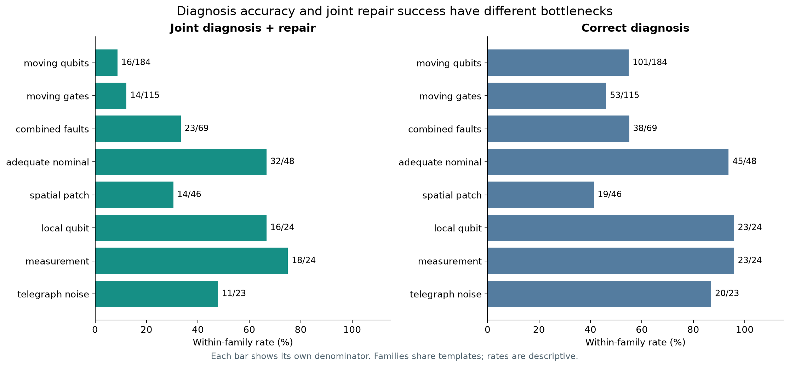
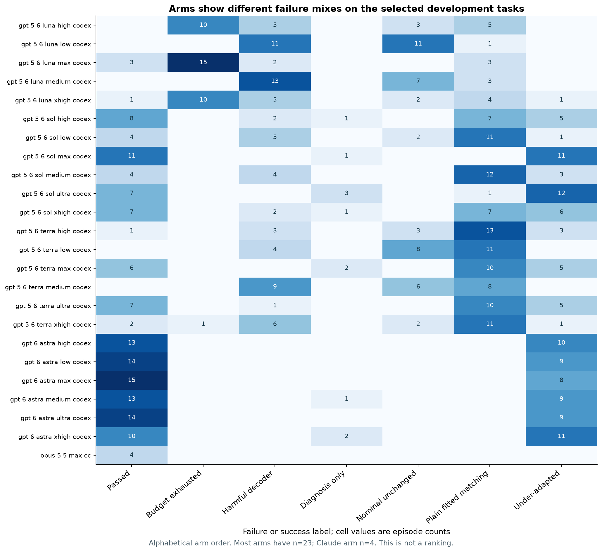

# QEC-Drift failure mode atlas

Snapshot: 2026-11-10T23:31:10.554169+00:00. Status: **complete**.

The audit inventories 760 decoder runs and 760 available score-linked transcripts. 760 have current exact-input judgments. The frozen rule includes 713 runs and excludes 47.
Among valid runs, 59 have no scored decoder and 47 carry a scorer or missing-submission message. These are overlapping counts. Fixed scoring timeouts remain failures; provider or environment invalidations are excluded from capability rates.

[Interactive atlas Page](https://chatgpt.com/space/page_22edfbe3fcf881918fdacb641af85579). [Download aggregate JSON](failure-atlas.json). The self-contained `index.html` also works as a local interactive artifact.

## Where development runs fail

The current development set has 144/533 relative joint passes. A pass requires both the diagnosis and the decoder to clear the stored rule. The largest rule failure groups are fitted plain matching and insufficient adaptation. Transcript judgments are shown separately and never rewrite the stored success rates.
A deterministic check found 4 development judge labels claiming sufficient repair despite a measured gap or drift recovery below the required 0.5 floor. Unknown historical metrics are exempt. The raw labels are preserved, and this check does not estimate full judge accuracy.







## Coverage by cohort

| Cohort | Recorded | Valid | Invalid | Available transcripts | Current judgments |
|---|---:|---:|---:|---:|---:|
| agent_decoder | 30 | 30 | 0 | 30 | 30 |
| agent_drift | 14 | 14 | 0 | 14 | 14 |
| agent_hard | 25 | 25 | 0 | 25 | 25 |
| agent_hard2 | 27 | 27 | 0 | 27 | 27 |
| agent_launch | 74 | 27 | 47 | 74 | 74 |
| agent_trial | 1 | 1 | 0 | 1 | 1 |
| agent_launch2 | 533 | 533 | 0 | 533 | 533 |
| fresh | 56 | 56 | 0 | 56 | 56 |

## Why the labels apply

| Label | Evidence described by the gate | Suggested next check |
|---|---|---|
| Rule-excluded run | External failure invalidated the run. | Repair the environment or provider gate and rerun. |
| Passed | Diagnosis and repair both cleared the relative rule. | Test replication on a held-out task family. |
| Budget exhausted | No scorable decoder at the tool or time deadline. | Keep a working decoder early and bound expensive searches. |
| No submission | The agent stopped without a decoder. | Check required deliverables before stopping. |
| Broken decoder | The decoder crashed, timed out, or returned an invalid result. | Validate the decode interface and runtime on held-out calibration data. |
| Harmful decoder | The submitted decoder scored below nominal plain matching. | Retain a validated fallback and reject damaging fits. |
| Diagnosis only | The repair was sufficient but the diagnosis failed. | Validate scope, time variation, and changed-qubit localization. |
| Nominal unchanged | The decoder stayed behaviorally nominal or used nominal source. | Verify deployment evidence changes the actual decoding model. |
| Plain fitted matching | A fitted model omitted correlations and fell short. | Test whether correlated or time-conditioned decoding improves held-out loss. |
| Under-adapted | A fitted correlated decoder recovered too little loss. | Measure regime tracking, calibration, and temporal adaptation separately. |

## Measurement limits

These development examples were checked against frozen transcript inputs. They illustrate observed mechanisms; their prevalence and causal effect were not estimated.

**A validation shape error can send the agent in the wrong direction.** A development trace compared an (N, 1) prediction array with an (N,) label array. Broadcasting made the comparison an N by N matrix. The agent then replaced nominal matching with an ensemble that scored worse than nominal matching. Suggested check: Normalize prediction and label shapes before using validation loss to select a decoder.

**The inferred regime can be routed to the wrong decoder.** One archived decoder returned argmax class indices as locations, then compared those indices directly with physical qubit IDs. Its correlated decoder closed some nominal gap but failed the drift-recovery requirement. Suggested check: Map classifier indices back to physical IDs and test the dispatch path.

**A working repair can still have a failed diagnosis.** A reviewed development episode named all 49 circuit qubits when 21 were actually changed. Its decoder cleared the repair thresholds, while the over-broad report failed localization. Suggested check: Evaluate localization precision and recall separately from decoder performance.

**Exploration can consume the submission budget.** Several reviewed traces used all 40 tool calls on probes and debugging before writing decoder.py. These are budget failures, even when some intermediate analyses found useful evidence. Suggested check: Write and test a valid fallback decoder before expensive exploration.

Every recorded decoder score row is inventoried. Current score-linked attempts are reviewed; superseded attempts are archived, not separate benchmark observations. Missing archives remain explicit.

Rendered views shorten long messages and tool outputs. Long views keep the first 40,000 and last 110,000 characters. This is review of every available run, not exhaustive reading of every raw byte or hidden reasoning.

Two damaged historical gzip archives supply 27 selected records recovered before compression errors. Their stored decoder and report fields were checked against the score rows, but those recovered records are not checksum verified.

The earlier launch cohort has 47 frozen env_missing exclusions. All 47 traces contain a required-module import error. The original gate excludes these runs even when an agent later recovers or submits a scorable decoder. The transcript judge assigned non-invalid labels to all 47. This historical eligibility dispute is retained; neither the original exclusions nor the raw judgments are overwritten.

The 704 historical rows lack attempt IDs and use the last matching untagged record. All 704 archived decoder sources matched the score rows; 541 archived report objects also matched. This does not remove ambiguity between historical reruns with identical outputs.

Historical cohorts, development, and fresh seeds have different task sets. Fresh arm coverage is availability selected and sparse. Charts are descriptive and do not establish a model ranking or causal explanation.

Fresh score and event hashes are verified. Failed fresh decoder subtypes use a later work-folder source snapshot which was not bound into the original attempt hashes. They are provisional; stored success scores remain authoritative.

The earlier numerical-answer pilot has 64 model episodes and a different task/output contract. It is excluded from the decoder taxonomy; its 96-row episode table is a task fixture, not 96 additional model runs.

Model-assisted judgments; partial identifier masking, not independent human ground truth.

The earlier research closeout ended at documented provider and hosted-execution gates. This atlas does not imply that unrun planned grid cells were completed. No new model ranking or causal claim follows from this descriptive audit.

## Reproduce

```sh
uv run python scripts/failure_atlas.py PRIVATE_FROZEN_INPUTS OUTPUT_DIRECTORY
uv run --with matplotlib python scripts/failure_atlas_plots.py OUTPUT_DIRECTORY/failure-atlas.json OUTPUT_DIRECTORY/plots
```

Private inputs contain the transcript evidence and exact judgment keys. Public aggregates omit raw transcripts and fresh candidate identities. The aggregate JSON records input hashes. Figures are also exported as SVG.
